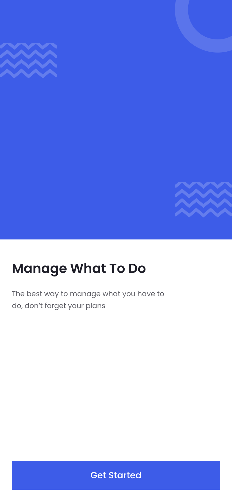
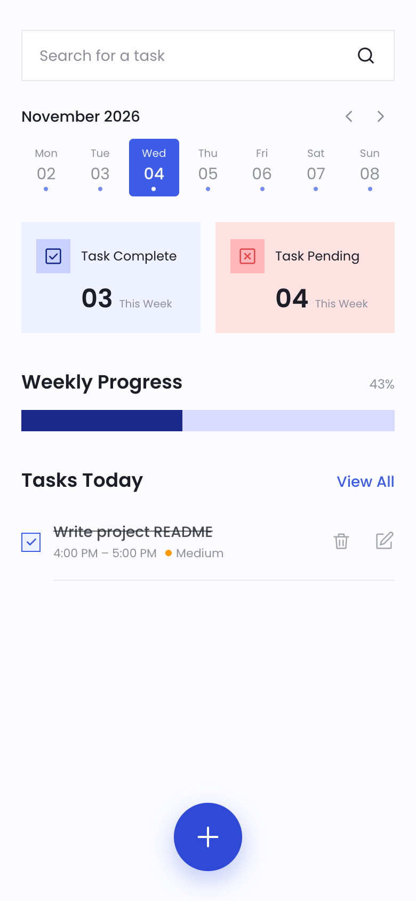
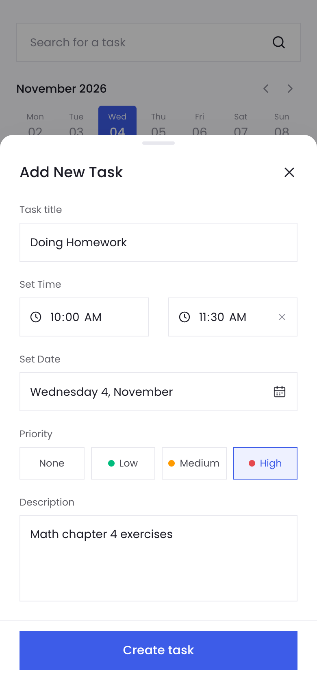
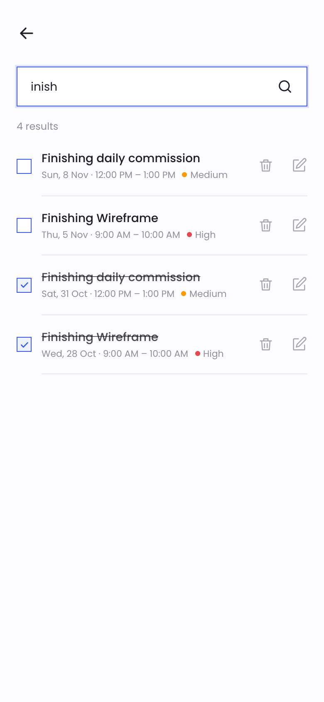
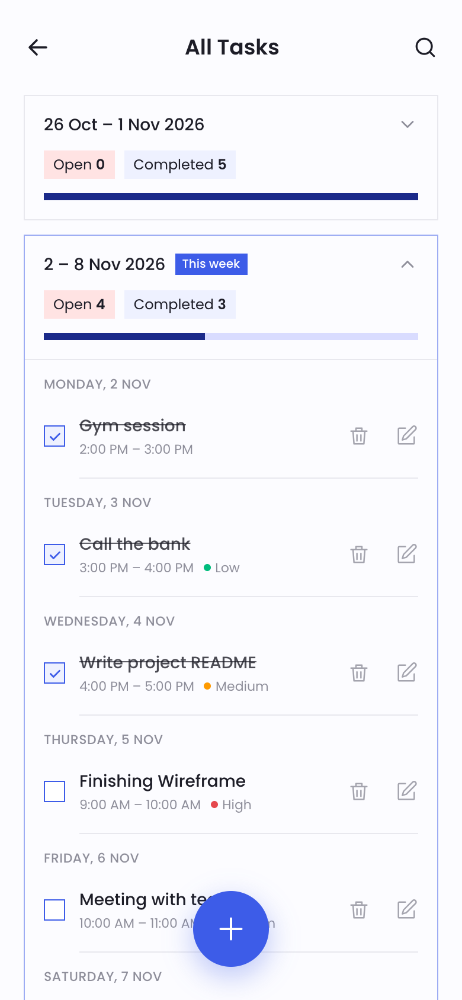

# To-Do List — MERN

A mobile-first to-do app: create, edit, delete and search tasks, mark them **Completed** or **In Progress**,
and track progress week by week (Monday → Sunday). Built from the provided Figma design.

**Live demo:** _coming soon_ · **API:** _coming soon_

> The API runs on Render's free tier and sleeps when idle, so the first request after a while can take ~50 s.

<table>
  <tr>
    <td></td>
    <td></td>
    <td></td>
    <td></td>
    <td></td>
  </tr>
  <tr>
    <td align="center">Onboarding</td>
    <td align="center">Home</td>
    <td align="center">Add task</td>
    <td align="center">Search</td>
    <td align="center">All tasks (weeks)</td>
  </tr>
</table>

## Features

- **Tasks** — title and date & start time (required), end time, priority (Low / Medium / High) and description (optional).
  An end time earlier than the start means the task runs past midnight.
- **Edit / view / delete** — tap a task to view it, the pencil to edit, and **swipe left** (or tap the trash icon) to reveal **Delete**.
- **Status** — tick the checkbox to mark a task Completed / In Progress; counts and progress update instantly
  (optimistic updates, rolled back if the server rejects the change).
- **Weekly overview** — Monday–Sunday week strip with Task Complete / Task Pending cards and a Weekly Progress bar;
  **View All** shows one card per week (open vs. completed) that expands to that week's tasks, grouped by day.
- **Search** — keyword search across title and description, with view / edit / complete / delete from the results.
- **Per-browser lists** — no sign-up: each browser gets an anonymous id, so visitors only see their own tasks.
- **Responsive & accessible** — phone-first layout (centred column on desktop), keyboard support, focus-trapped dialogs,
  loading / empty / error states.

## Tech stack

| Layer    | Stack |
| -------- | ----- |
| Frontend | React 19, Vite, Tailwind CSS v4, React Router, TanStack Query, date-fns |
| Backend  | Node.js, Express 5, Mongoose (MongoDB), Zod validation, Helmet, rate limiting |
| Testing  | `node:test` + Supertest against an in-memory MongoDB |
| Hosting  | Netlify (client) · Render (API) · MongoDB Atlas (database) |

## Project structure

```
client/   React app — see client/README.md
server/   REST API  — see server/README.md (full endpoint reference)
docs/     Screenshots
netlify.toml
```

## Run locally

Requirements: **Node 22.12+** and MongoDB (local install, Docker, or an Atlas connection string).

```bash
# 1. Database (skip if you use Atlas or a local MongoDB)
docker run -d --name todo-mongo -p 27017:27017 -v todo-mongo-data:/data/db mongo:7

# 2. API → http://localhost:4000
cd server
npm install
cp .env.example .env          # set MONGODB_URI if not using the default local one
npm run dev

# 3. Client → http://localhost:5173 (a second terminal; /api is proxied to :4000)
cd client
npm install
npm run dev
```

**Sample data** (optional): open the app once, copy your browser's id from the dev-tools console with
`localStorage.getItem('todo:client-id')`, then run `npm run seed -- --client=<id>` in `server/`.

**Tests & checks**

```bash
cd server && npm test                 # API tests (no database needed)
cd client && npm run lint && npm run build
```

## API overview

All task routes require an `X-Client-Id: <uuid>` header (the client sends it automatically).

| Method | Path | Description |
| ------ | ---- | ----------- |
| GET    | `/api/health` | `200` when the database is connected, `503` otherwise |
| GET    | `/api/tasks?from&to&status&priority` | List tasks in a date range |
| GET    | `/api/tasks/search?q=` | Keyword search (title + description) |
| GET    | `/api/tasks/summary?date&tz` | Open / completed counts and progress for the Mon–Sun week containing `date` |
| GET    | `/api/tasks/weeks?tz` | One summary per week that has tasks |
| GET / PATCH / DELETE | `/api/tasks/:id` | Read, update (any field, incl. `status`), delete |
| POST   | `/api/tasks` | Create |

Weeks are computed in the user's time zone (`tz`, e.g. `Asia/Kolkata`). Details, validation rules and examples:
[server/README.md](server/README.md).

## Deployment

1. **MongoDB Atlas** — free M0 cluster, a database user with read/write on `todo`, network access `0.0.0.0/0`.
2. **Render (API)** — new Web Service from this repo: root `server`, build `npm ci`, start `npm start`,
   health check `/api/health`. Environment: `MONGODB_URI`, `NODE_ENV=production`,
   `CORS_ORIGIN=https://<your-site>.netlify.app` (required in production).
3. **Netlify (client)** — import this repo; build settings come from [`netlify.toml`](netlify.toml).
   Environment: `VITE_API_URL=https://<your-api>.onrender.com/api` (read at build time, so redeploy after changing it).
4. Set `CORS_ORIGIN` on Render to the final Netlify URL, then open the site and add a task.

## Design decisions

- **Weekly grouping in the user's time zone.** Dates are stored in UTC; the client sends its IANA time zone and the
  API groups with MongoDB's `$dateTrunc` (`startOfWeek: monday`), so a task at 11 pm Sunday stays in the right week.
- **Figma vs. spec.** The design shows Start/End times and no priority; the spec requires one date & time and an
  optional priority. The app stores a required `startAt` plus an optional `endAt`, and adds a priority selector in the
  design's style. Delete supports both the spec's swipe gesture and the design's trash icon.
- **Anonymous per-browser ownership** instead of accounts keeps the scope of the assignment while preventing
  visitors of the public demo from seeing or deleting each other's tasks.
